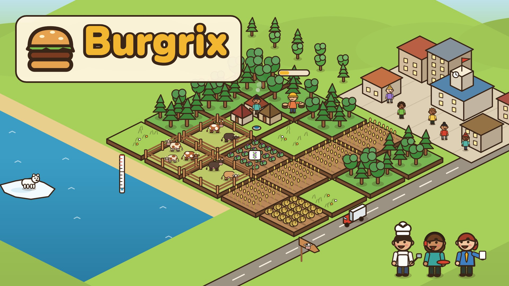
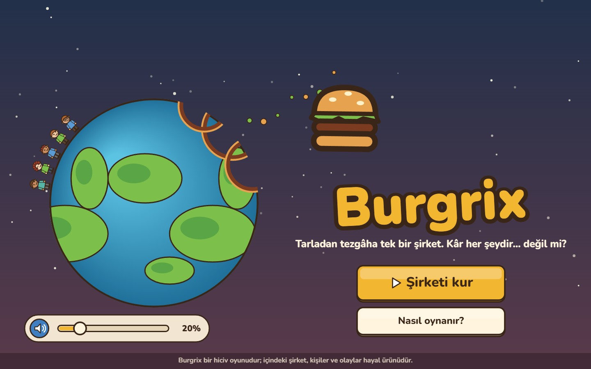
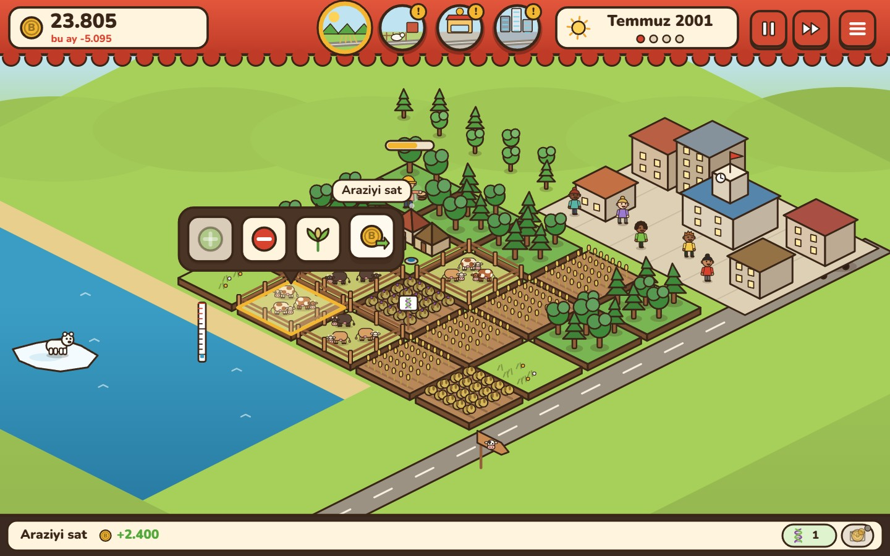
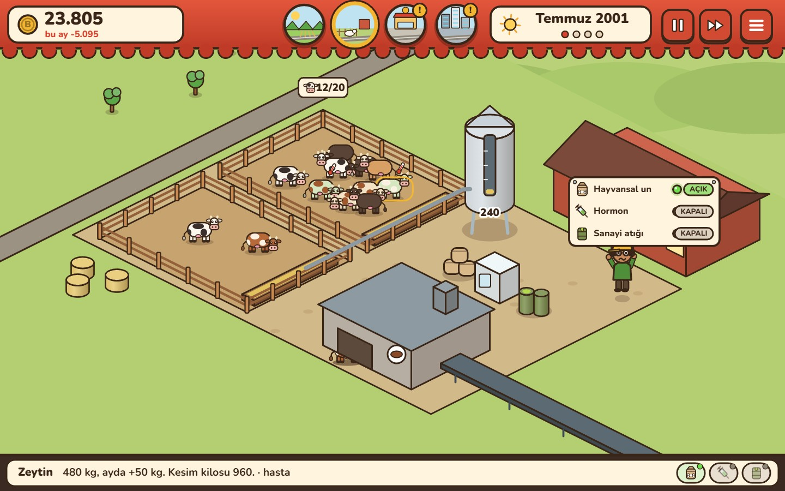
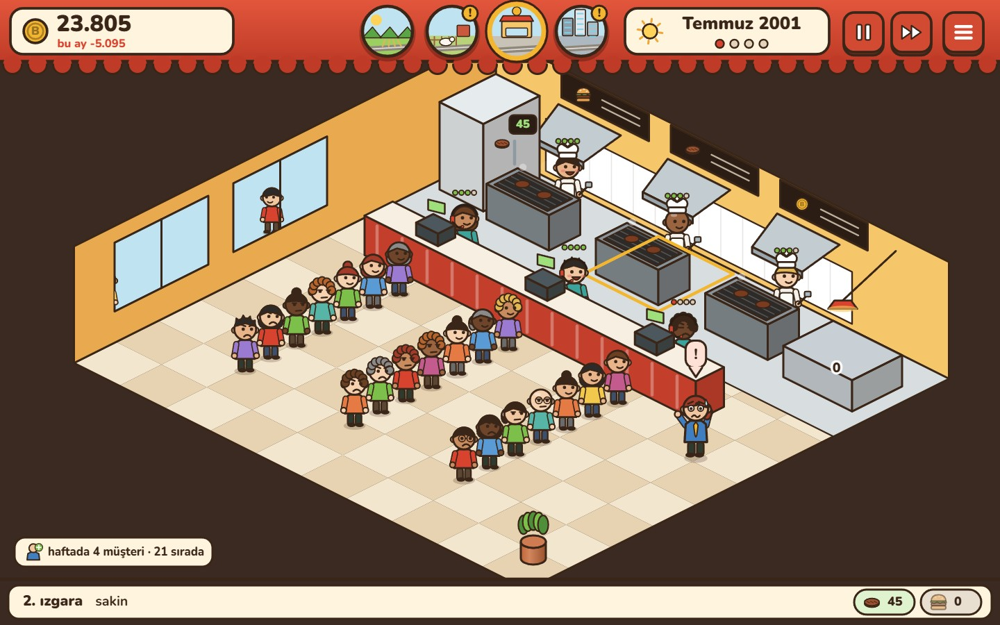
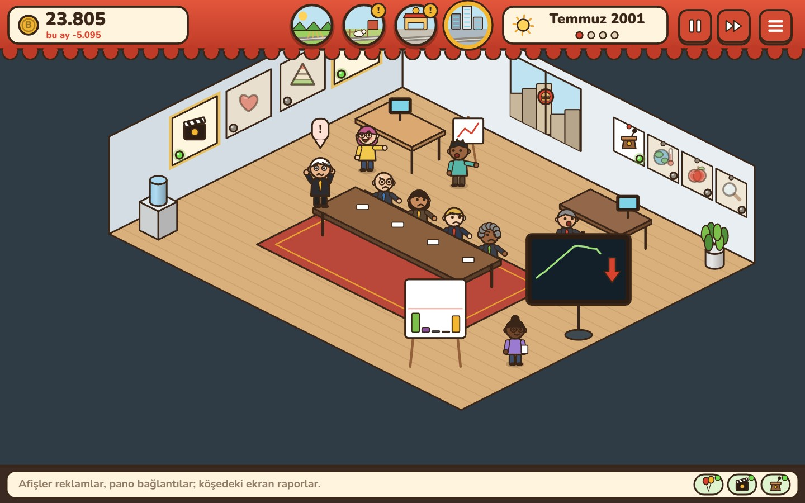

# Burgrix

Fast food zinciri yönetimi üzerine hicivli bir strateji oyunu (HTML5 Canvas, TypeScript). Kurallar [docs/rules.md](docs/rules.md), tasarım ve teknik ayrıntılar [GDD.md](GDD.md).



## Ekran görüntüleri

| | |
|---|---|
|  |  |
| Ana menü | Tarlalar: parseller, kasaba, deniz ve bağlam düğmeleri |
|  |  |
| Besi çiftliği: ağıllar, silo ve katkı panosu | Restoran: mutfak, kasalar ve kuyruklar |
|  | |
| Genel merkez: reklamlar, bağlantılar, kurul ve raporlar | |

## Çalıştırma

| Komut | Ne yapar |
|---|---|
| `npm install` | Bağımlılıkları kurar |
| `npm run dev` | Geliştirme sunucusu; `?lang=en` İngilizce |
| `npm run build` | Tür denetimi ve üretim derlemesi (`dist/`, statik dosyalar) |
| `npm test` | Kural ve arayüz testleri |

Derlenen `dist/` klasörü statiktir; herhangi bir web sunucusunda ya da statik barındırmada çalışır.

## Yayın (GitHub Pages)

`main` dalına her push'ta `.github/workflows/pages.yml` testleri çalıştırır, oyunu derler ve GitHub Pages'te yayınlar. İlk seferde repoda **Settings → Pages → Source: GitHub Actions** seçilmelidir. Oyun `https://<kullanıcı>.github.io/<repo>/` adresinde açılır; İngilizce için sona `?lang=en` eklenir.

## İçeriği değiştirmek

- **Metinler:** `public/game/tr.json`, `public/game/en.json` (aynı anahtarlar; derleme gerekmez).
- **Sesler:** `public/game/sounds.json` (sentez tarifleri; derleme gerekmez).
- **Sayılar ve denge:** `src/sim/config.ts`; kurallar değişirse önce `docs/rules.md`.
- **Çizimler:** `src/ui/` (çizim kiti `draw.ts`, kişiler `people.ts`, inekler `cows.ts`, simgeler `icons.ts`, sahneler `scenes/`).

## Yapı

```
docs/rules.md   oyunun kuralları (simülasyonun tek kaynağı), cover.jpg
src/sim/        kurallar: durum, haftalık adım, komutlar, olaylar
src/ui/         ekran: sahneler, çubuklar, pencereler, menü
src/audio/      ses sentezi ve çalma
public/game/    metinler, ses tarifleri, yazı tipi
tests/          kural ve arayüz testleri
```

## Lisans

Kod ve içerik [MIT lisansı](LICENSE) ile dağıtılır. Nunito yazı tipi kendi lisansıyla gelir: [SIL Open Font License](public/game/fonts/OFL.txt).
